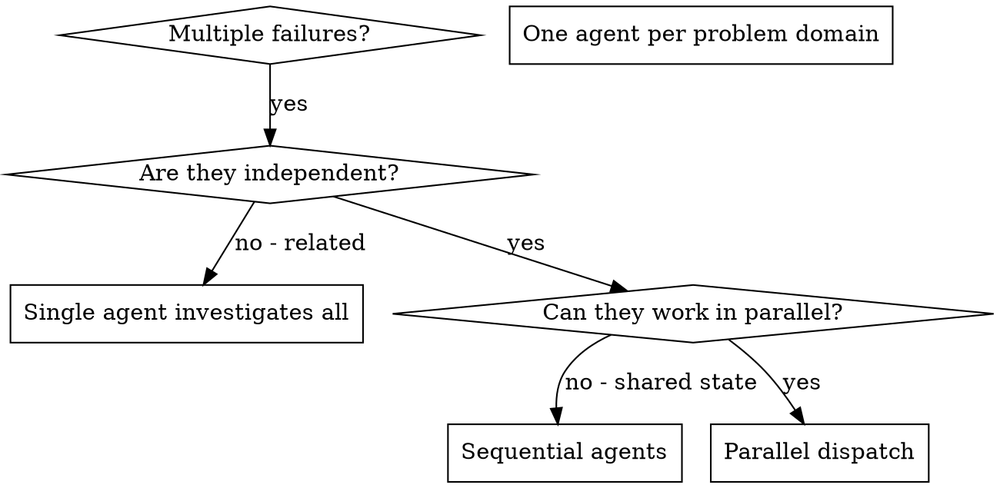

# 派发并行智能体

## 概述

你把任务委派给具有隔离上下文的专用智能体。通过精确地编写它们的指令和上下文，你确保它们保持专注并成功完成任务。它们绝不应继承你本会话的上下文或历史 —— 你精确构建它们所需的一切。这也为你自己的协调工作保留了上下文。

当你面对多个不相关的失败（不同的测试文件、不同的子系统、不同的 bug）时，逐个调查会浪费时间。每次调查都是独立的，可以并行进行。

**核心原则：** 每个独立的问题域派发一个智能体。让它们并发工作。

## 何时使用



**在以下情况使用：**
- 3 个以上测试文件因不同的根本原因而失败
- 多个子系统各自独立地损坏
- 每个问题无需其他问题的上下文即可理解
- 各次调查之间没有共享状态

**在以下情况不要使用：**
- 失败相互关联（修好一个可能修好其他）
- 需要理解完整的系统状态
- 智能体之间会互相干扰

## 模式

### 1. 识别独立的问题域

按出错的对象对失败进行分组：
- 文件 A 的测试：工具审批流程
- 文件 B 的测试：批量完成行为
- 文件 C 的测试：中止功能

每个领域都是独立的 —— 修复工具审批不影响中止测试。

### 2. 创建聚焦的智能体任务

每个智能体获得：
- **具体范围：** 一个测试文件或一个子系统
- **清晰目标：** 让这些测试通过
- **约束：** 不修改其他代码
- **预期输出：** 你所发现和修复内容的摘要

### 3. 并行派发

在同一次响应中发出全部三个子智能体派发 —— 它们并行运行：

```text
Subagent (general-purpose): "Fix agent-tool-abort.test.ts failures"
Subagent (general-purpose): "Fix batch-completion-behavior.test.ts failures"
Subagent (general-purpose): "Fix tool-approval-race-conditions.test.ts failures"
# All three run concurrently.
```

在一个响应中发出多个派发调用 = 并行执行。每个响应一个 = 顺序执行。

### 4. 审查与整合

当智能体返回时：
- 阅读每份摘要
- 核实修复不冲突
- 运行完整测试套件
- 整合所有变更

## 智能体提示词结构

好的智能体提示词是：
1. **聚焦的** - 一个清晰的问题域
2. **自包含的** - 理解问题所需的全部上下文
3. **对输出有明确要求** - 智能体应返回什么？

```markdown
Fix the 3 failing tests in src/agents/agent-tool-abort.test.ts:

1. "should abort tool with partial output capture" - expects 'interrupted at' in message
2. "should handle mixed completed and aborted tools" - fast tool aborted instead of completed
3. "should properly track pendingToolCount" - expects 3 results but gets 0

These are timing/race condition issues. Your task:

1. Read the test file and understand what each test verifies
2. Identify root cause - timing issues or actual bugs?
3. Fix by:
   - Replacing arbitrary timeouts with event-based waiting
   - Fixing bugs in abort implementation if found
   - Adjusting test expectations if testing changed behavior

Do NOT just increase timeouts - find the real issue.

Return: Summary of what you found and what you fixed.
```

## 常见错误

**❌ 太宽泛：** “修复所有测试” - 智能体会迷失方向
**✅ 具体：** “修复 agent-tool-abort.test.ts” - 范围聚焦

**❌ 无上下文：** “修复竞态条件” - 智能体不知道在哪里
**✅ 有上下文：** 粘贴错误消息和测试名称

**❌ 无约束：** 智能体可能会重构一切
**✅ 有约束：** “不要修改生产代码”或“只修复测试”

**❌ 模糊输出：** “修好它” - 你不知道改了什么
**✅ 具体：** “返回根本原因和变更的摘要”

## 何时不要使用

**相关的失败：** 修好一个可能修好其他 - 先一起调查
**需要完整上下文：** 理解需要看到整个系统
**探索性调试：** 你还不知道什么坏了
**共享状态：** 智能体之间会干扰（编辑相同文件、使用相同资源）

## 会话中的真实示例

**场景：** 重大重构后，3 个文件中共有 6 个测试失败

**失败情况：**
- agent-tool-abort.test.ts：3 个失败（时序问题）
- batch-completion-behavior.test.ts：2 个失败（工具未执行）
- tool-approval-race-conditions.test.ts：1 个失败（执行次数 = 0）

**决策：** 独立的领域 - 中止逻辑与批量完成、竞态条件彼此分离

**派发：**
```
Agent 1 → Fix agent-tool-abort.test.ts
Agent 2 → Fix batch-completion-behavior.test.ts
Agent 3 → Fix tool-approval-race-conditions.test.ts
```

**结果：**
- 智能体 1：用基于事件的等待替换了超时
- 智能体 2：修复了事件结构 bug（threadId 位置错误）
- 智能体 3：添加等待，以让异步工具执行完成

**整合：** 所有修复相互独立，无冲突，完整测试套件通过

## 验证

智能体返回后：
1. **审查每份摘要** - 理解改了什么
2. **检查冲突** - 智能体是否编辑了相同的代码？
3. **运行完整套件** - 核实所有修复协同工作
4. **抽查** - 智能体可能犯系统性错误
