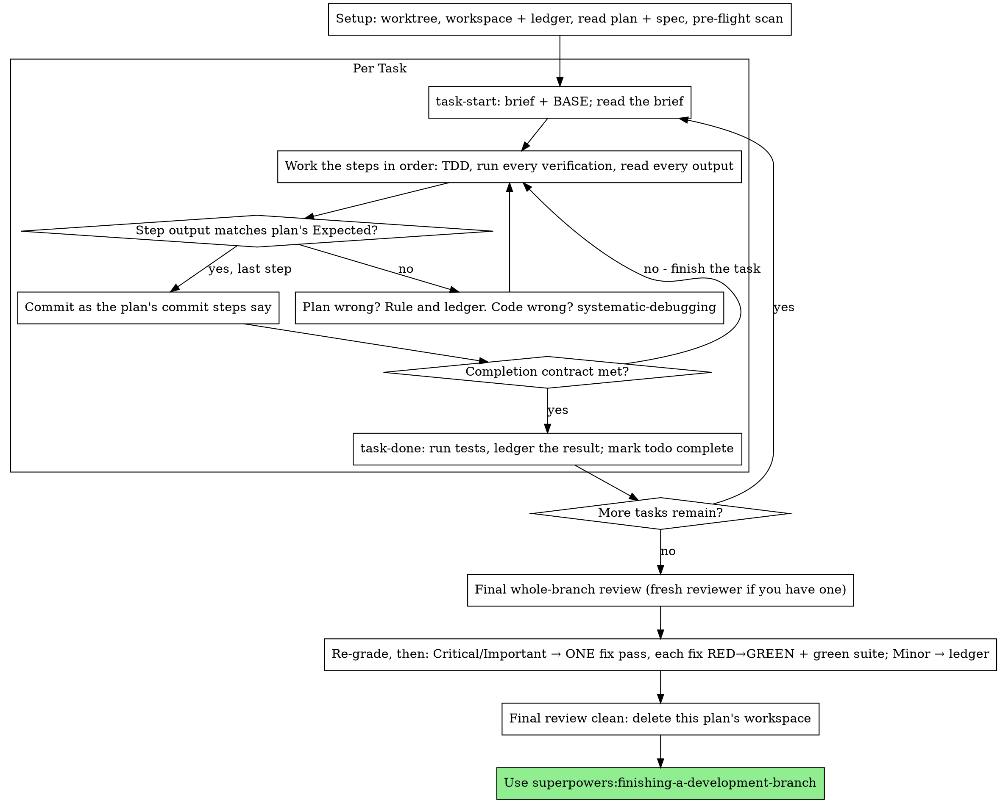

# 执行计划

在本会话中由你自己逐任务执行计划：每个任务没有实现者子智能体，每个任务没有审查者。最后对整个分支做一次全新上下文的审查。

**为什么用内联：** 子智能体驱动开发会为每个任务支付一个全新实现者和一个全新审查者的成本，各自从零重读代码库。内联执行只需付出一个上下文（你的）再加最后一位审查者。它放弃的是每个任务的全新上下文和每个任务的第二双眼睛。此技能通过其他手段保住那两样东西带来的成果：任务简报就是规格，进度台账就是你的记忆，TDD 是每个任务的关卡，最终审查者就是第二双眼睛。

**核心原则：** 计划已经完成了思考。严格按计划执行，用一个你亲眼看着先失败、再通过的测试来证明每一步，并留下一条能扛过你自己遗忘的记录。

**叙述：** 在工具调用之间，最多叙述一行短话 —— 进度台账和工具结果承载记录。

**持续执行：** 不要在任务之间停下来与你的人类伙伴确认。他们选择内联执行是为了少花钱，而不是为了在每个任务后回答“我该继续吗？”。不停顿地执行计划中的所有任务。

**做裁决，不停滞。** 冲突、歧义、计划缺陷 —— 自行决定它们。规格是具有约束力的权威，计划是它的论证，而你的判断解决两者都未回答的问题。把每个决定记录在进度台账中，格式为 `Ruling: <你决定了什么> — <为什么> — <如果错了代价是什么>`，然后继续。没有记录裁决就偏离计划，是一个在暗处做出的决定。

有四件事会让你停下来，且只有这些：不可逆或破坏性的操作；安全敏感的操作；在此工作树之外的、按惯例应先询问的副作用（一次合并、向共享分支推送、一次发布）；以及一个破损到每条前进路径都只能靠猜的计划。遇到这些，停下来并询问。

## 何时使用

- 你有一份来自 superpowers:writing-plans 的计划，并且你的人类伙伴在交接时选择了内联执行。
- 你的运行框架没有子智能体工具（见 `../using-superpowers/references/` 中按平台划分的参考文件）。绝不要伪造派发；在这里执行计划。
- 任务大多相互独立 —— 与 superpowers:subagent-driven-development 相同的前提条件。

一份完整规定的计划会让内联执行变成“照抄加测试”：它在中等水平的会话模型上也能运行良好，而最强模型真正值得其成本的唯一环节是最终审查，此技能会单独派发它。当你的人类伙伴选择内联执行时，把这一点告诉他们。

当你的人类伙伴希望每个任务都有审查关卡时，或者当计划长到其后续任务会在被压缩的上下文上运行时，优先选择 superpowers:subagent-driven-development。对长计划做内联执行仍然可行 —— 进度台账正是让它可恢复的东西 —— 但最后几个任务得到你最少的心力。

## 流程

## 准备

确保工作在隔离的工作区中进行：使用 superpowers:using-git-worktrees 创建一个，或核实已有的一个。未经你的人类伙伴明确同意，绝不在 main/master 分支上开始实现。

对话记忆无法在压缩后保留。一个丢失了进度的内联执行者会重新实现那些提交已存在的任务 —— 这与控制器重新派发它们是同一种失败，只是用你自己的上下文来付出代价。在进度台账文件中跟踪进度，而不仅仅在待办里。运行框架的待办是实时视图；进度台账才是记录。

工作区和进度台账与 superpowers:subagent-driven-development 共享 —— 相同目录、相同格式 —— 这样一个计划可以在中途更换执行者，而新的执行者会从同一份台账继续。

- 每个计划拥有一个工作区：在技能开始时，运行 `../subagent-driven-development/scripts/sdd-workspace PLAN_FILE` —— 它会打印该计划被 git 忽略的目录（`<repo-root>/.superpowers/sdd/<plan-basename>/`），此计划的每个产物都存放于此：进度台账、简报、审查包。另一个计划的目录永远不是你可以读写的。
- 在 `<workspace>/progress.md` 检查此计划的进度台账。如果它的第一行指明你的计划文件，那么带有 `Task <N>: complete` 行的任务就是已完成 —— 不要重做；从第一个没有该行的任务继续。它们的提交存在于 git 中，即使你的上下文不再记得做过它们：压缩之后，要相信进度台账和 `git log`，而不是你自己的回忆。一份第一行指明不同计划文件的台账属于另一个计划的进度：别动它，另起一份全新的。
- 创建进度台账，以它的身份作为第一行：`# SDD ledger — plan: <plan file path>`。
- `git clean -fdx` 会摧毁工作区（它是被 git 忽略的临时空间）；如果发生这种情况，从 `git log` 恢复。

通读一遍计划，记下它的上下文和全局约束，并为每个任务创建一个待办。如果计划指名了一份规格，也读它：规格是计划据以论证的权威，计划内部的冲突依据它来解决。没有可及规格的计划要在进度台账中记一条说明 —— 在没有规格的情况下做出的裁决都是暂定的。

**必需子技能：** 现在、在任务 1 之前，加载 superpowers:test-driven-development。它支配下面每个任务的每一步；一个其步骤已经写着“先写失败的测试”的计划，并不能免除你阅读它。

在任务 1 之前，扫描计划中任务之间的冲突。计划的 Interfaces 块会告诉你该看哪里：对于每一个消费先前任务所产出内容的任务，记一行台账 —— 这两个任务、一个产出什么相对于另一个消费什么，以及你发现了什么。不共享任何东西的任务不记行；任务之间不共享任何东西的计划只记一行 `Pre-flight: no shared interfaces`。以规格为具有约束力的权威，对每一行台账所揭示的冲突做出裁决，把裁决记录在对应行旁，然后开始任务 1。每个任务自身的文本在你阅读其简报时检查，而不是在这里。

## 任务循环

你打印的一切、以及每一个工具结果，都会在会话余下时间里驻留在你的上下文中。把冗长的测试输出重定向到工作区中的文件，并读取其末尾；读简报，而不是整份计划。

### 1. 领取任务

- 运行此技能的 `scripts/task-start PLAN_FILE N`。它在一次调用中打印简报路径和 BASE（该任务范围所切自的提交）。为每个任务阅读简报，包括你在准备阶段记得的那些：你记住的是摘要，简报里才有确切的值、签名和测试用例。
- 将该任务的待办标记为进行中。

每次工具调用都是重新读取你整个上下文的一轮。记账要搭着工作一起做 —— 在同一调用里追加台账并提交，绝不要单独占用一次调用。

### 2. 执行步骤

计划的步骤已经按 RED-GREEN 顺序排列；在准备阶段加载的 superpowers:test-driven-development 之下，按该顺序遵循它们。测试步骤的代码先写、先运行。看它失败是一个步骤，不是走过场 —— 一个在实现存在之前就通过的测试，是关于该测试的一条发现。

每个运行命令的步骤都有一行 `Expected:`。运行命令，读取其输出，然后比较。三种结果：

- **匹配。** 下一步。
- **代码有错。** 使用 superpowers:systematic-debugging。找到原因；绝不要为了让步骤输出匹配而粉饰症状。
- **计划有错** —— 某一步与规格矛盾、先前任务的某个接口与本任务所消费的不符、某条命令根本无法运行。对满足规格的最小改动做出裁决，记为 `Task <N>: Ruling: <发现> — <你决定了什么以及为什么>`，然后继续。裁决是被携带的，而不是被记住的：后续触及同一接口的任务会从台账中读到它。

按计划的提交步骤所写的那样提交。一个任务跨多个提交是可以的；BASE 是审查范围的切自点，绝不是 `HEAD~1`。

### 3. 完成契约

在一个任务的台账行之前，以下各项都成立，并带有本会话中的证据 —— 而不是从 diff 看起来正确推断出来的：

- 简报所点名的每个测试都存在并在本任务中运行过，且你读过输出。
- 该任务的最终测试运行通过了 —— `task-done` 就是那次运行，它会把命令和结果写入台账行。
- 简报中的每一行 `Expected:` 都与真实输出做过比较。
- 与简报的每一处偏离都在台账中有一行 `Ruling:`。

**必需子技能：** superpowers:verification-before-completion 支配这一声称。如果缺少任何一项，任务就未完成：把它完成。

### 4. 完成任务

用简报为整个任务指定的测试命令，运行此技能的 `scripts/task-done PLAN_FILE N BASE -- <test command>`。它运行测试，把完整输出保存在工作区，打印末尾，并且 —— 仅当它们通过时 —— 才把完成行追加到台账：

`Task <N>: complete (commits <base7>..<head7>, tests: <command> → <result>)`

失败的运行什么也不记录；任务未完成。当它记录时，把待办标记为完成并领取下一个任务。

## 最终审查

运行 `../subagent-driven-development/scripts/review-package PLAN_FILE MERGE_BASE HEAD`（MERGE_BASE = 该分支起始的提交，例如 `git merge-base main HEAD`），并从它打印的文件进行审查。

**有子智能体工具时：** 用可用的最强模型派发审查者 —— 整个分支的审查是一项判断任务 —— 使用 superpowers:requesting-code-review 的 [code-reviewer.md](../requesting-code-review/code-reviewer.md)，附上审查包路径、计划与规格路径、计划的 Review Focus 部分（如有则逐字给出，即计划的测试未覆盖的输入类别和失败模式 —— 审查者会逐一故意检查），以及一个指向台账中 `Ruling:` 各行的指引，以便它权衡你所做的裁决。显式指定模型；省略模型会继承会话的模型，而那可能并非最强。这是整次运行所购买的唯一一个全新上下文。不要跳过它，也不要用你自己对 diff 的阅读来替代它。

**没有子智能体工具时：** 阅读 code-reviewer.md，并在最后一个任务的台账行之后，作为一个单独的环节，对审查包自行执行那次审查。把 `Final review: self-review (no subagent tool)` 写入台账，并在最终消息中说明这一点：作者的自审弱于一位全新审查者，你的人类伙伴在合并前决定这是否足够。

在对任何发现采取行动之前，先对它们排序。审查者的严重程度标签是建议；关卡是你的。它的“拒绝评判”清单也是你的：那里每一行都是一项你要做出并记录的裁决，正如同一个计划冲突 —— `Final: Ruling: <审查者搁置的行为> — <使用此软件的合理用户会得到什么，以及为什么这可以成立，或为什么它现在是一条发现> — <如果错了的代价>`。先按实际效果重新评级：规格是一份愿景文档，一条发现的等级取决于合理用户若发布后会得到什么，而不是规格是否指名了触发它的输入 —— 一位审查者因规格未提及而把某条发现定为 Minor，是给规格评了级，而不是给实际效果评级。然后：

- **Critical 和 Important** 进入修复环节。
- **Minor** 作为 `Final: minor (deferred): <一句话>` 进入台账，并在最终消息的“Deferred minors”下列出。Minor 永不进入修复环节，也永不成为裁决 —— 裁决是关于冲突的决定，而不是“你拒绝了一条润色建议”的记录。

你自己修复 Critical 和 Important 发现 —— 在这里你就是实现者 —— 一趟完成。每个修复都通过 TDD 来验证，而不是靠第二位审查者：写出复现该发现的测试，看着它失败，使它通过，然后运行整套测试。把每一个记录进台账，格式为 `Final: fixed <finding> — <test name> RED→GREEN, suite <N>/<N>`。没有先失败的测试的修复不算得到验证；修复环节之后测试套件不是绿的，就说明该环节尚未结束。不要派发重新审查：那会重读一个 diff，而它覆盖的测试已经回答了“已处理”，它的套件运行已经回答了“没有破坏任何东西”。

你决定不修复的一条发现就是一项裁决 —— `Final: Ruling: <finding> — <为什么代码站得住> — <如果错了的代价>` —— 并会出现在裁决清单中传达给你的人类伙伴。没有第二次修复环节。

## 收尾

在你删除任何东西之前，把台账中每一行包含 `Ruling:` 的内容收集到最终消息的“Rulings I made”下，按你做出它们的顺序排列，每条都注明如果错了的代价，并把每一行 `minor (deferred)` 收集到“Deferred minors”下。两个清单都是穷尽的。你的最终消息是唯一能把你代表人类伙伴所做的决定 —— 以及你选择不采取行动的发现 —— 传达给他们的地方。

当最终审查干净、其修复已提交时，删除此计划的工作区目录 —— 现在 git 历史就是记录。同级的其他目录属于其他计划；别动它们。

使用 superpowers:finishing-a-development-branch。

## 常见借口

| 借口 | 实际情况 |
|--------|---------|
| “我记得任务 N 说了什么” | 你记住的是摘要。简报里有确切的值。去读它。 |
| “计划的代码是对的，跳过看测试失败吧” | 一个你从未见它失败的测试证明不了任何东西。它是一个步骤。运行它。 |
| “我会在最后跑整套测试，而不是每个步骤都跑” | 逐步骤运行才能让你知道是哪一步弄坏了它。任务结束时的运行是契约，不是替代品。 |
| “计划这里错了，我就做对的事” | 做对的事，并把裁决记入台账。未记入台账的偏离是一个在暗处做出的决定。 |
| “我会在完成几个任务后再写台账行” | 压缩不会等一个方便的时刻。每个任务一行，与提交放在同一条消息里。 |
| “让我在下一个任务前确认一下” | 他们选择内联是为了少花钱。进度询问反而会花掉他们的时间。只有那四种停顿会让你停下。 |
| “我很仔细地读了自己的 diff；最终审查者是多余的” | 同一个作者，同样的盲区。审查者是整次运行所购买的唯一一个全新上下文。 |
| “测试应该会通过，改动微不足道” | “应该”不是证据。契约要求命令及其输出。 |
| “子智能体又慢又贵，我也跳过最终审查吧” | 内联已经移除了每任务的审查者。对整个分支的一次审查是下限，不是上限。 |
| “审查者说是 Minor，那就是 Minor” | 那个标签给规格的沉默评了级。要给用户实际得到的东西评级。重新评级，然后过关卡。 |
| “修复显而易见，不需要先写失败的测试” | 失败的测试是唯一能证明该发现真实存在且现已消失的证据。没有它，你只有一份 diff 和一个希望。 |
| “我都在这儿了，顺便把次要问题也修了吧” | 你修复的每个次要问题都是一次测试、一次修复和一次套件运行，是你的伙伴没要求的。把它们记入台账；由你的伙伴决定。 |
