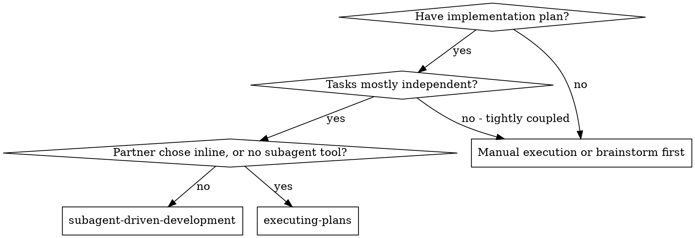
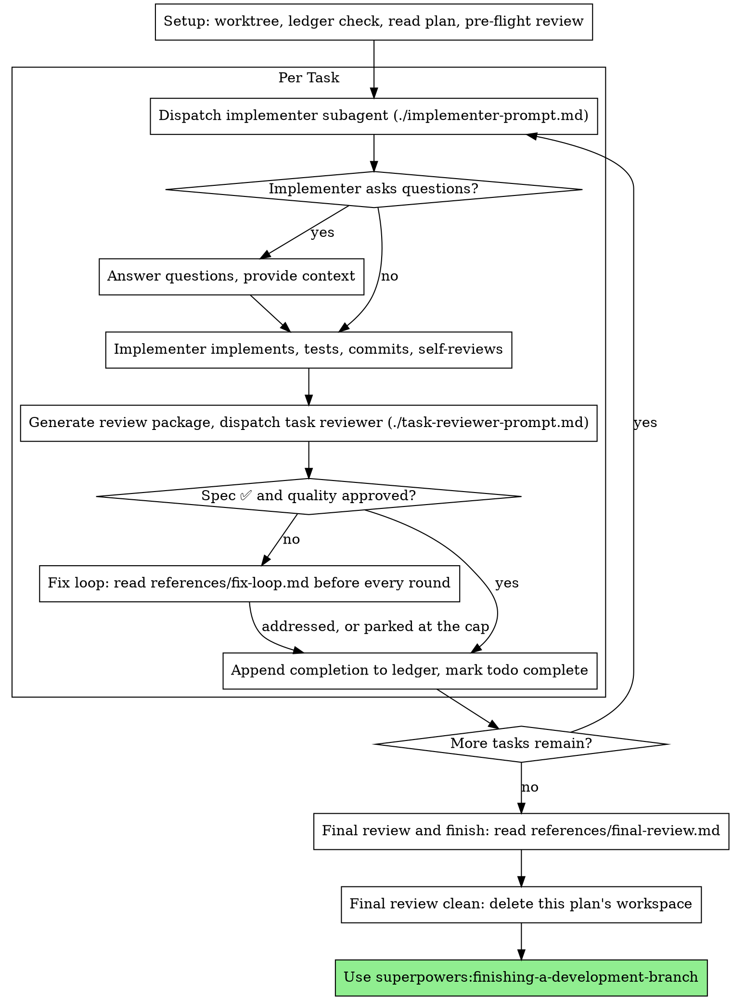

# 子智能体驱动开发

通过为每个任务派发一个全新的实现者子智能体、在每个任务之后做一次任务审查（规格符合度 + 代码质量）、并在最后做一次广泛的全分支审查来执行计划。

**为什么用子智能体：** 你把任务委派给具有隔离上下文的专用智能体。通过精确地编写它们的指令和上下文，你确保它们保持专注并成功完成任务。它们绝不应继承你本会话的上下文或历史 —— 你精确构建它们所需的一切。这也为你自己的协调工作保留了上下文。

**核心原则：** 每个任务一个全新子智能体 + 任务审查（规格 + 质量）+ 广泛最终审查 = 高质量、快速迭代

**叙述：** 在工具调用之间，最多叙述一行短话 —— 进度台账和工具结果承载记录。

**持续执行：** 不要在任务之间停下来与你的人类伙伴确认。不停顿地执行计划中的所有任务。停下来的唯一理由是下面提到的四条，或者所有任务完成。“我该继续吗？”的询问和进度摘要会浪费他们的时间 —— 他们让你去执行计划，那就去执行它。

**做裁决，不停滞。** 一个运行中的计划不会等待人类。冲突、歧义、计划缺陷、一个你本会请求突破的上限 —— 自行决定它们。规格是具有约束力的权威，计划是它的论证，而你的判断解决两者都未回答的问题。把每个决定记录在进度台账中，格式为 `Ruling: <你决定了什么> — <为什么> — <如果错了代价是什么>`，然后继续。一个错误的裁决代价是你的 人类伙伴看得见、也能撤销的重做；一次停在某个问题上的会话代价是他们一整天，却什么也换不来。

有四件事会让你停下来，且只有这些：不可逆或破坏性的操作；安全敏感的操作；在此工作树之外的、按惯例应先询问的副作用（一次合并、向共享分支推送、一次发布）；以及一个破损到每条前进路径都只能靠猜的计划。遇到这些，停下来并询问。

## 何时使用

**对比 执行计划（内联）：**
- 每个任务一个全新子智能体（无上下文污染），而不是一个上下文做每个任务
- 每个任务之后审查（规格符合度 + 代码质量），而不是只在最后
- 每个任务、每次审查都要付出一个全新上下文的成本；内联只需付出一个上下文加一位最终审查者
- 两者都在本会话中运行，共享同一计划工作区和进度台账，且在任务之间从不暂停

## 流程

## 准备

确保工作在隔离的工作区中进行：使用 superpowers:using-git-worktrees 创建一个，或核实已有的一个。未经你的人类伙伴明确同意，绝不在 main/master 分支上开始实现。

对话记忆无法在压缩后保留。在真实会话中，丢失了进度的控制器曾重新派发整个已完成的任务序列 —— 这是所观察到的最昂贵的一次失败。在进度台账文件中跟踪进度，而不仅仅在待办里。

- 每个计划拥有一个工作区：在技能开始时，运行此技能的 `bash scripts/sdd-workspace PLAN_FILE` —— 它会打印该计划被 git 忽略的目录（在 `<repo-root>/.superpowers/sdd/` 下），此计划的每个产物都存放于此：进度台账、简报、报告、审查包。另一个计划的目录永远不是你可以读写的。
- 在 `<workspace>/progress.md` 检查此计划的进度台账。如果存在，先读 [references/resuming.md](references/resuming.md) 再做其他任何事：它说明这份台账属于谁、从哪里继续。
- 创建进度台账，以它的身份作为第一行：`# SDD ledger — plan: <plan file path>`。
- 进度台账是你的恢复地图：它列出的提交存在于 git 中，即使你的上下文不再记得创建过它们。压缩之后，要相信进度台账和 `git log`，而不是你自己的回忆。
- `git clean -fdx` 会摧毁工作区（它是被 git 忽略的临时空间）；如果发生这种情况，从 `git log` 恢复。

通读一遍计划，记下它的上下文和全局约束，并为每个任务创建一个待办。如果计划指名了一份规格，也读它：规格是计划据以论证的权威，计划内部的冲突依据它来解决。没有可及规格的计划要在进度台账中记一条说明 —— 在没有规格的情况下做出的裁决都是暂定的。

在派发任务 1 之前，读 [references/preflight.md](references/preflight.md) 并运行它描述的冲突扫描。它的表格和裁决记入进度台账。

## 模型选择

使用能胜任每个角色的最不强力的模型，以节约成本并提高速度。

**机械式实现任务**（隔离的函数、清晰的规格、1-2 个文件）：使用快速、便宜的模型。当计划规定得好时，大多数实现任务都是机械式的。

**整合与判断任务**（多文件协调、模式匹配、调试）：使用标准模型。

**架构与设计任务：** 使用可用的最强模型。最终的全分支审查就属于这类 —— 用可用的最强模型派发它，而不是会话默认模型。

**审查任务：** 用同样的判断来选择模型，按其 diff 的规模、复杂度和风险来缩放。一个小的机械式 diff 不需要最强模型；一处微妙的并发改动则需要。对小修复 diff 的限定性重审属于便宜到中等档。

**修复循环升级（第 4-5 轮）：** 使用比卡住的那个实现者至少高一档的模型。

**派发子智能体时始终显式指定模型。** 省略模型会继承你所在会话的模型 —— 通常是最强也最贵的 —— 这会无声地让本节失效。

**轮数比 token 价格更重要。** 实际耗时和上下文成本与子智能体所走的轮数成正比，而最便宜的模型在多步骤工作上常常要走 2-3 倍的轮数 —— 总体上更贵。把中等档模型作为审查者、以及依据散文式描述工作的实现者的下限。当任务的计划文本包含要写的完整代码时，实现就是“照抄加测试”：该实现者使用最便宜的档位。单文件的机械式修复也使用最便宜的档位。

**任务复杂度信号（实现任务）：**
- 触及 1-2 个文件且有完整规格 → 便宜的模型
- 触及多个文件且有整合顾虑 → 标准模型
- 需要设计判断或广泛的代码库理解 → 最强的模型

## 任务循环

**小型的同型工作：** 当计划列出跨文件的若干个同类小改动时，在派发它们之前读 [references/batching.md](references/batching.md)。

你粘贴进派发提示词的一切 —— 以及子智能体打印回来的一切 —— 都会在会话余下时间里驻留在你的上下文中，并在之后每一轮被重新读取。把产物以文件形式移交。

**等待已派发的子智能体：** 绝不用短超时轮询等待接口，也绝不陷入一次静默、无期限的等待。当你有本地工作 —— 更新进度台账、打包下一次审查、阅读报告 —— 就继续工作；子结果会自行到达。当你确实空闲时，按有界的时间段等待（在你平台允许的情况下，五到十分钟），并在各时间段之间发布一行状态并核对你的活跃子智能体：列出它们，并追查任何已完成却未报告的子智能体。有界的时间段几乎保留了长时间等待的全部效率，同时保证卡住或丢失的子智能体会在几分钟内被注意到，而不是在会话结束时。

### 1. 派发实现者

在派发之前记录 BASE（`git rev-parse HEAD`）—— 审查包和修复轮次的 diff 需要它。

- **任务简报：** 在派发实现者之前，运行此技能的 `bash scripts/task-brief PLAN_FILE N` —— 它把任务的完整文本提取到一个唯一命名的文件中，并打印该路径。这样组织派发内容，使简报保持为需求的唯一来源。你的派发内容应包含：(1) 一行说明本任务在项目中的位置；(2) 简报路径，并以“先读这个 —— 这是你的需求，其中包含可逐字使用的确切值”来引入；(3) 简报无法知晓的来自先前任务的接口和决定；(4) 你对简报中注意到的任何歧义的解决办法；(5) 报告文件路径和报告契约。确切值（数字、魔法字符串、签名、测试用例）只出现在简报中。绝不要让子智能体读整个计划文件。
- **报告文件：** 以简报来命名实现者的报告文件（简报 `…/task-N-brief.md` → 报告 `…/task-N-report.md`），并把它放进派发提示词。实现者在那里写完整报告，只返回状态、提交、一行测试摘要和关切。
- 一条派发提示词只描述一个任务，而不是会话的历史。不要把累积的先前任务摘要（“任务 1-3 后的状态”）粘贴进后续派发 —— 一次真实会话的派发内容达到了 42k 字符，其中 99% 是粘贴的历史。一个全新子智能体需要的是它的任务、它所触及的接口，以及全局约束。别的都不需要。
- 派发内容带有“不使用子智能体”的契约（它在实现者模板中）：实现者绝不派发子智能体 —— 不用帮手，也绝不用审查者。审查由你提供，在报告之后。在真实会话中，工人所生成的每一位审查者，都与控制器本来就会派发的任务审查重复 —— 每个任务多出一个完整的审查席位。
- 如果较早的任务在本任务触及的领域搁置了一条发现，就在派发内容中携带指向该台账条目的指引。
- 从派发结果中记录实现者的智能体身份 —— 修复循环第 1-3 轮会恢复这个智能体。
- 绝不要并行派发多个实现子智能体（会冲突）。

模板：[implementer-prompt.md](implementer-prompt.md)

### 2. 处理报告

实现者子智能体报告四种状态之一。分别妥善处理：

**DONE：** 生成审查包（`bash scripts/review-package PLAN_FILE BASE HEAD`，从此技能目录运行 —— 它打印它所写的唯一文件路径；BASE 是你在派发实现者之前记录的提交 —— 绝不是 `HEAD~1`，那会静默地丢掉多提交任务中除最后一个之外的所有提交），然后用打印出的路径派发任务审查者。

**任何其他状态**（DONE_WITH_CONCERNS、NEEDS_CONTEXT、BLOCKED）：读 [references/handling-reports.md](references/handling-reports.md) 并遵循它，每次收到都如此。

如果实现者提问 —— 无论是在开始前还是任务中途 —— 都要清楚而完整地回答，如有需要提供额外上下文，不要催它赶紧开始实现。

### 3. 审查任务

每个任务的审查是任务范围的关卡。广泛审查只发生一次，在最终的全分支审查时。绝不要跳过任务审查，也绝不接受缺少任一结论的报告 —— 规格符合度和任务质量两者都必需。实现者自审绝不替代任务审查；两者都需要。

- 把审查者的 diff 作为文件交给它：运行此技能的 `bash scripts/review-package PLAN_FILE BASE HEAD`，把打印出的文件路径传给审查者（或者，在没有 bash 时：对该范围运行 `git log --oneline`、`git diff --stat` 和 `git diff -U10`，重定向到一个唯一命名的文件）。输出绝不进入你自己的上下文，审查者能在一次 Read 调用中看到提交列表、统计摘要和带上下文的完整 diff。使用你在派发实现者之前记录的 BASE —— 绝不是 `HEAD~1`，那会静默截断多提交任务。绝不要在没有 diff 文件的情况下派发任务审查者。
- **审查者输入：** 任务审查者获得三个路径 —— 同一个简报文件、报告文件、审查包 —— 加上约束该任务的全局约束。
- 你交给审查者的全局约束块就是它的注意力透镜。从计划的 Global Constraints 部分或规格中逐字复制具有约束力的要求：确切的值、确切的格式，以及所述组件之间的关系（“与 X 相同的布局”、“与 Y 匹配”）。审查者的模板已经承载了流程规则（YAGNI、测试卫生、审查方法）—— 约束块是用于说明这个项目的规格要求什么。
- 没有具体的、任务特定理由时，不要添加“检查所有用法”或“如有用则运行竞态测试”这类开放式指令
- 不要让审查者重新运行实现者已经在同一代码上运行过的测试 —— 实现者的报告承载测试证据
- 不要替审查者预判发现 —— 绝不指示审查者忽略或不标记某个具体问题。如果你认为某条发现会是误报，就让审查者提出它，并在审查循环中裁决。如果你正在写的提示词包含“不要标记”“不要把 X 当作缺陷”“最多 Minor”或“计划选择了”—— 停下：你在预判，通常是为了替自己省掉一轮审查循环。
如果审查者报告“⚠️ 无法从 diff 核实”的条目，在把任务标记为完成之前读 [references/cannot-verify.md](references/cannot-verify.md)。

模板：[task-reviewer-prompt.md](task-reviewer-prompt.md)

### 4. 修复循环

当审查报告规格 ❌、任何 Critical 或 Important 发现，或你确认为真实缺口的 ⚠️ 条目时，循环触发。

当它触发时，读 [references/fix-loop.md](references/fix-loop.md) 并遵循它。在每一轮之前再读一遍，即使你在本会话早些时候读过：它包含轮数上限、断路器，以及每轮写入的台账行，而你对此的记忆无法在压缩后保留。

### 5. 完成任务

当审查干净返回 —— 或每条未决发现都在达到上限时带着裁决被搁置 —— 就把完成行追加到台账，与你其他记账放在同一条消息里：

- `Task <N>: complete (commits <base7>..<head7>, review clean)`
- `Task <N>: complete (commits <base7>..<head7>, <K> parked)` after a tripped breaker

然后标记待办完成并继续。当审查还有未决的 Critical/Important 问题时，绝不进入下一个任务，除非它们已修复，或在达到上限时带着裁决被搁置。

## 最终审查

当每个任务都完成时，读 [references/final-review.md](references/final-review.md) 并遵循它。它涵盖全分支审查、其单次修复波，以及你如何收尾。

## 常见借口

| 借口 | 实际情况 |
|--------|---------|
| “规格符合度差不多就够了” | 审查者发现了规格缺口 = 未完成。要么修复，要么到达上限并裁决 —— 这是仅有的出口。 |
| “我自己修，派发是开销” | 控制器的修复会污染你的上下文并跳过审查。恢复实现者。 |
| “再来一轮就会收敛” | 超过上限后，轮次不会收敛 —— 失败是结构性的。裁决并改道。 |
| “审查者反正会找到新东西” | 限定性重审只核实修复；它们不会乱跑。对未触及代码的新发现记入台账，而不进入循环。 |
| “这条发现明显是错的，我丢掉它” | 你只在到达上限时裁决，且每条裁决都是一条台账记录。禁止静默丢弃。 |
| “修复很小，跳过重审” | 未经审查的修复正是回归落地的方式。每一轮都以限定性重审结束。 |
| “审查拖慢了循环” | 没有审查的循环只是未经核实的空转。审查是循环的刹车和转向。 |
| “台账记账是开销” | 进度台账才是压缩后仍存活的东西。没有台账的控制器曾重新派发整个已完成的任务序列。 |
| “实现者生成了它自己的审查者 —— 免费的额外保障” | 那是一个重复的席位，审查同一份 diff；任务审查才是关卡。工人生成的审查者是一个应被标记的缺陷，而不是严谨。 |
