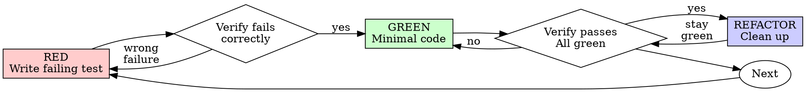

# 测试驱动开发（TDD）

## 概述

先写测试。看着它失败。写最少的代码让它通过。

**核心原则：** 如果你没有亲眼看着测试失败，你就不知道它测的是不是正确的东西。

**违反规则的字面就是违反规则的精神。**

## 何时使用

**始终：**
- 新功能
- 缺陷修复
- 重构
- 行为变更

**例外（询问你的人类伙伴）：**
- 一次性原型
- 生成的代码
- 配置文件

想着"就这一次跳过 TDD"？停下。那是合理化。

## 铁律

```
没有失败的测试，就不写生产代码
```

在测试之前写代码？删掉它。重新开始。

**没有例外：**
- 不要把它留作"参考"
- 不要在写测试时"改造"它
- 不要看它
- 删掉就是删掉

从测试开始全新实现。就是这样。

## 红-绿-重构



### RED - 编写失败的测试

写一个最小的测试，展示应该发生什么。

<Good>
```typescript
test('retries failed operations 3 times', async () => {
  let attempts = 0;
  const operation = () => {
    attempts++;
    if (attempts < 3) throw new Error('fail');
    return 'success';
  };

  const result = await retryOperation(operation);

  expect(result).toBe('success');
  expect(attempts).toBe(3);
});
```
名称清晰，测试真实行为，只测一件事
</Good>

<Bad>
```typescript
test('retry works', async () => {
  const mock = jest.fn()
    .mockRejectedValueOnce(new Error())
    .mockRejectedValueOnce(new Error())
    .mockResolvedValueOnce('success');
  await retryOperation(mock);
  expect(mock).toHaveBeenCalledTimes(3);
});
```
名称含糊，测的是 mock 而不是代码
</Bad>

**要求：**
- 一个行为
- 清晰的名称
- 真实代码（除非不可避免，否则不用 mock）

### 验证 RED - 看着它失败

**强制要求。绝不跳过。**

```bash
npm test path/to/test.test.ts
```

确认：
- 测试失败（而不是报错）
- 失败信息符合预期
- 失败是因为功能缺失（而不是拼写错误）

**测试通过了？** 你在测既有行为。修正测试。

**测试报错？** 修复错误，重新运行，直到它正确地失败。

### GREEN - 最少的代码

写最简单的代码让测试通过。

<Good>
```typescript
async function retryOperation<T>(fn: () => Promise<T>): Promise<T> {
  for (let i = 0; i < 3; i++) {
    try {
      return await fn();
    } catch (e) {
      if (i === 2) throw e;
    }
  }
  throw new Error('unreachable');
}
```
刚好足够通过
</Good>

<Bad>
```typescript
async function retryOperation<T>(
  fn: () => Promise<T>,
  options?: {
    maxRetries?: number;
    backoff?: 'linear' | 'exponential';
    onRetry?: (attempt: number) => void;
  }
): Promise<T> {
  // YAGNI
}
```
过度设计
</Bad>

不要添加功能、重构其他代码，或超出测试去"改进"。

### 验证 GREEN - 看着它通过

**强制要求。**

```bash
npm test path/to/test.test.ts
```

确认：
- 测试通过
- 其他测试仍然通过
- 输出干净（没有错误、警告）

**测试失败？** 修代码，不要改测试。

**其他测试失败？** 现在修。

**"其他测试"指的是项目的测试套件，而不只是你那个文件。** 你写的那个测试跑绿，并不等于整个套件是绿的。在宣布改动完成之前，运行项目的测试命令（裸的 `pytest`、`npm test`、`cargo test`——代码仓库用什么就用什么），即使你的任务只点名了一个测试文件。任务里的范围声明界定的是交付物，不是你的验证。那次运行所显示的每一个失败——包括不是你造成的——都要点名写进你的报告；一个你看着它滚过去却只字未提的红色测试，是一份因沉默而造假的报告。

### REFACTOR - 清理

只在变绿之后：
- 消除重复
- 改进命名
- 提取辅助函数

保持测试为绿。不要添加行为。

### 重复

下一个功能的下一个失败测试。

## 好的测试

| 质量 | 好 | 坏 |
|---------|------|-----|
| **最小** | 只做一件事。名称里有"和"？拆开它。 | `test('validates email and domain and whitespace')` |
| **清晰** | 名称描述行为 | `test('test1')` |
| **体现意图** | 展示期望的 API | 掩盖代码应该做什么 |

在编写或更改任何测试时，阅读 [writing-good-tests.md](writing-good-tests.md) 了解让测试保持诚实的规则：
- 在编写测试之前，先点名会让该测试失败的生产代码改动
- 断言真实行为，绝不断言 mock 行为
- 把仅用于测试的代码放在测试工具里，不要放进生产类
- 在 mock 某个依赖之前，理解它的副作用

## 常见的合理化

| 借口 | 现实 |
|--------|---------|
| "太简单了，不用测" | 简单的代码也会坏。测试只需 30 秒。 |
| "我事后测" | 事后写的测试会立即通过——这什么都证明不了。它们可能测错东西、测实现而非行为，或漏掉你忘记的边界情况。你从没看着它失败，就从未证明它能抓住这个缺陷。测试先行强制产生那次失败。 |
| "事后测试达到同样的目标（重精神不重仪式）" | 事后测试回答"它做什么？"；测试先行回答"它应该做什么？"事后写的测试会受你已写代码的偏见影响——你验证的是你记得的那些情况，而不是你本会发现的情况。有覆盖率，却没有测试有效的证明。 |
| "已经手动测过了" | 手动测试是临时的：没有覆盖了什么的记录，代码一改就无法重跑，压力下容易漏掉情况。"我试的时候是好的" ≠ 全面。自动化测试每次都一样地运行。 |
| "删掉 X 小时很浪费" | 沉没成本谬误——那段时间无论如何都已经花掉了。真正的选择是：用 TDD 重写（高信心）vs. 保留它事后补测试（低信心、很可能有缺陷）。保留你无法信任的代码才是浪费。 |
| "留作参考，先写测试" | 你会去改造它。那就是事后测试。删掉就是删掉。 |
| "需要先探索" | 可以。把探索丢掉，从 TDD 开始。 |
| "测试难写 = 设计不清晰" | 听测试的。难测 = 难用。 |
| "TDD 会拖慢我" | TDD 就是务实之路：在提交前抓住缺陷、防止回归、让你能无所畏惧地重构。"务实"的捷径意味着在生产环境里调试——更慢，而不是更快。 |
| "手动测试更快" | 手动不能证明边界情况。每次改动你都会重新测一遍。 |
| "既有代码没有测试" | 你正在改进它。为既有代码补测试。 |

## 危险信号 - 停下并重新开始

- 测试之前写代码
- 实现之后才写测试
- 测试立即通过
- 说不清测试为什么失败
- 测试是"稍后"才加的
- 为"就这一次"找理由
- "我已经手动测过了"
- "事后测试达到同样目的"
- "重点是精神，不是仪式"
- "留作参考"或"改造既有代码"
- "已经花了 X 小时，删掉很浪费"
- "TDD 太教条，我在务实"
- "这次不一样，因为……"

**所有这些都意味着：删掉代码。用 TDD 重新开始。**

## 示例：缺陷修复

**缺陷：** 空邮箱被接受

**RED**
```typescript
test('rejects empty email', async () => {
  const result = await submitForm({ email: '' });
  expect(result.error).toBe('Email required');
});
```

**验证 RED**
```bash
$ npm test
FAIL: expected 'Email required', got undefined
```

**GREEN**
```typescript
function submitForm(data: FormData) {
  if (!data.email?.trim()) {
    return { error: 'Email required' };
  }
  // ...
}
```

**验证 GREEN**
```bash
$ npm test
PASS
```

**REFACTOR**
如有需要，为多个字段提取校验逻辑。

## 验证清单

在标记工作完成之前：

- [ ] 每个新函数/方法都有一个测试
- [ ] 在实现之前看着每个测试失败
- [ ] 每个测试因预期原因失败（功能缺失，而不是拼写错误）
- [ ] 写最少的代码让每个测试通过
- [ ] 所有测试通过
- [ ] 输出干净（没有错误、警告）
- [ ] 测试使用真实代码（仅在不可避免时才用 mock）
- [ ] 边界情况和错误已覆盖

不能勾选所有框？你跳过了 TDD。重新开始。

## 卡住时

| 问题 | 解决办法 |
|---------|----------|
| 不知道怎么测 | 写出你期望的 API。先写断言。询问你的人类伙伴。 |
| 测试太复杂 | 设计太复杂。简化接口。 |
| 什么都得 mock | 代码耦合太紧。使用依赖注入。 |
| 测试准备太庞大 | 提取辅助函数。仍然复杂？简化设计。 |

## 调试集成

发现缺陷？写一个能复现它的失败测试。走 TDD 循环。测试证明修复并防止回归。

没有测试就绝不修缺陷。

## 最终规则

```
生产代码 → 测试存在，且先失败过
否则 → 不是 TDD
```

没有你的人类伙伴的许可，没有例外。
